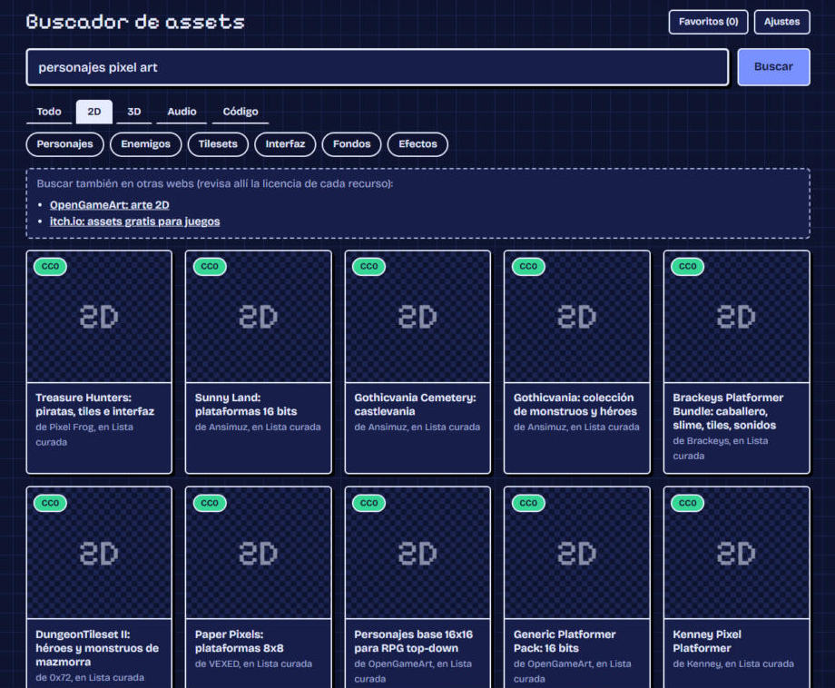

# Buscador de assets libres

[](https://github.com/Trotuga58/buscador-assets/actions/workflows/ci.yml)


[](LICENSE)

App de escritorio para encontrar **modelos 3D, sprites 2D, música y efectos de sonido** de varias fuentes en una sola búsqueda,
mostrando únicamente contenido **CC0** (dominio público): se puede usar en proyectos comerciales sin atribuir ni cumplir condiciones.

La hice porque al crear juegos y vídeos perdía mucho tiempo abriendo diez webs distintas y comprobando la licencia de cada asset.

<!-- Añade aquí una captura:  -->

## Qué hace

- **Búsqueda unificada** en Openverse, Freesound, Poly Pizza y una lista curada de packs para juegos, con resultados en un formato común.
- **Filtro de licencias en el servidor**: normaliza las licencias de cada fuente y descarta todo lo que no sea CC0 (BY, NC, SA, ND…).
- **Vista previa** según el tipo: visor 3D (`<model-viewer>`), reproductor de audio o miniatura.
- **Búsqueda en español**: traduce los términos más comunes al inglés antes de consultar las APIs.
- **Favoritos y descargas**: cada descarga se guarda con un `LICENCIA.txt` que indica su origen.
- **Caché en disco** para no gastar los límites de las APIs.
- **Conector MCP para Claude**: el mismo `.exe` expone las herramientas `search_assets` y `download_asset`, para que un asistente
  busque y descargue assets (por ejemplo para importarlos en Blender).

## Cómo está hecho

```
client/    React 19 + TypeScript (Vite): cuadrícula, filtros, vista previa, ajustes
server/    Node + TypeScript: API de búsqueda, caché, favoritos, descargas, servidor MCP
  src/adapters/   un adaptador por fuente con la misma interfaz
shared/    tipos compartidos entre cliente y servidor
electron/  envoltorio de escritorio (ejecutable portable de Windows)
docs/      diseño inicial y plan de implementación
```

Decisiones principales:

- **Patrón adaptador**: cada fuente implementa la misma interfaz, así que añadir o quitar una no toca el resto. Si una fuente falla,
  las demás siguen respondiendo y la interfaz lo indica en la barra de estado.
- **Las claves de API nunca llegan al navegador**: viven en el servidor local (`.env` o los ajustes del usuario de Windows), no en el código ni en el `.exe`.
- **Tests sin red**: cada adaptador se prueba contra respuestas de ejemplo en `server/src/adapters/__fixtures__/`, y
  `npm run smoke` lanza búsquedas reales contra las APIs configuradas.
- **CI en GitHub Actions**: typecheck y tests en cada push; otro workflow construye el `.exe` y lo publica en Releases.

## Probarlo

Descarga el `.exe` de la página de [Releases](https://github.com/Trotuga58/buscador-assets/releases) y ábrelo; no necesita instalación.
Windows puede avisar de "aplicación desconocida" porque el programa no está firmado: pulsa "Más información" y "Ejecutar de todas formas".

Sin claves ya funcionan la lista curada y Openverse. Para el resto, abre **Ajustes** y pega tus claves gratuitas:

| Variable | Fuente | Dónde se saca |
|---|---|---|
| `FREESOUND_API_KEY` | Freesound | https://freesound.org/apiv2/apply |
| `POLYPIZZA_API_KEY` | Poly Pizza | https://poly.pizza (ajustes de cuenta, sección API) |

## Desarrollo

Requiere Node.js 22.

```bash
npm install
cp .env.example .env     # opcional: o pega las claves en Ajustes
npm run dev:server       # http://127.0.0.1:3001
npm run dev:client       # en otra terminal; abre la dirección que imprime Vite
```

| Comando | Qué hace |
|---|---|
| `npm test` | tests del servidor y del cliente |
| `npm run typecheck` | comprobación de tipos |
| `npm run smoke` | búsqueda real contra cada API configurada |
| `npm run electron` | abre la app de escritorio sin empaquetar |
| `npm run dist` | crea `release/Buscador-de-assets.exe` |
| `npm run mcp` | arranca el conector MCP sin Electron |

## Conectar con Claude

1. Abre la app → **Ajustes** → "Conectar con Claude" → **Copiar configuración**.
2. Claude Desktop: Ajustes → Desarrollador → Editar configuración, pega el bloque en `claude_desktop_config.json` y reinicia Claude.
   Claude Code: `claude mcp add buscador-assets -- "C:\ruta\Buscador-de-assets.exe" --mcp`
3. Pide, por ejemplo: "busca una espada low poly y ponla en mi escena de Blender".

`download_asset` guarda el archivo en *Documentos → Buscador de assets → descargas*, con un `LICENCIA.txt` al lado.
Solo se descargan directamente los resultados que lo permiten (por ejemplo, modelos de Poly Pizza); los packs curados enlazan a la página del autor.

## Sobre las licencias

- Solo se muestra CC0. CC BY, OFL, Apache, NC y SA se descartan en el servidor.
- Por eso no hay pestaña de fuentes tipográficas (las libres son OFL/Apache, no CC0). Los adaptadores de Google Fonts y Sketchfab
  están en el código pero desactivados.
- La lista curada (`server/data/curated.json`) es una selección manual: confirma la licencia en la página del pack antes de usarlo.
- Esto es una ayuda, no asesoría legal.

## Licencia

[MIT](LICENSE)
